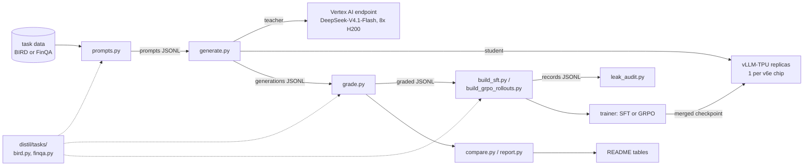

# Architecture

TPU-Distil has two parts. `distil/` is a set of standard-library Python scripts that make prompts, call models, grade answers, build training data, and report results. Every task-specific step goes through a task module in `distil/tasks/` (BIRD text-to-SQL, FinQA financial question answering), selected with `--task`. `trainer/` is a JAX trainer that fine-tunes the student on a TPU v6e-8 host. The parts share data only through JSONL files and Hugging Face checkpoints.

## Data flow

1. `prompts.py` turns each question into a fixed chat prompt from the task's template.
2. `generate.py` sends the prompts to the teacher or to student replicas and stores every raw response.
3. `grade.py` scores each response against the gold answer with the task's grader.
4. `build_sft.py` and `build_grpo_rollouts.py` turn graded responses into training records. `leak_audit.py` checks the records against the evaluation set.
5. The trainer runs SFT or GRPO and writes a merged checkpoint. The checkpoint goes back to step 2 for evaluation and RL rollouts.
6. `compare.py`, `report.py` and `compute_report.py` compute every published number from the stored files.

## `distil/` — pipeline

| Script | Input | Output |
|---|---|---|
| `tasks/__init__.py` | `--task bird\|finqa` | the task module; its docstring lists the interface every task provides |
| `tasks/bird.py` | BIRD files, SQLite databases | items, schema prompts, SQL extraction, execution match (group = database) |
| `tasks/finqa.py` | FinQA JSON files | items, report-text-and-table prompts, answer extraction, numeric grading with 1% relative tolerance (group = report page) |
| `bird.py` | — | re-exports `tasks/bird.py` for existing imports |
| `overlap.py` | question texts | exact and 13-gram word overlap, shared by `prompts.py` and `leak_audit.py` |
| `prompts.py` | a split | prompts JSONL `{id, <group>, messages}` and a manifest with the template SHA-256; can leave out training questions that share a group or text with the evaluation split |
| `generate.py` | prompts JSONL, endpoints | generations JSONL `{id, choices, usage, latency_s}`; resumes by id |
| `teacher_client.py` | — | HTTP client with retry and back-off, used by `generate.py` and `bench_serving.py` |
| `vertex_openai_proxy.py` | Vertex endpoint URL | local OpenAI-compatible endpoint with OAuth tokens |
| `serve_small.sh` | model directory, chip | one vLLM-TPU replica on one v6e chip, port 8100 + chip |
| `grade.py` | generations JSONL | graded JSONL `{id, sample, <prediction>, correct, error}` and a summary; `--control gold\|shuffled` |
| `build_sft.py` | prompts, generations, graded | SFT records (correct answers only, distinct answers, exact N) and a manifest |
| `correct.py` | a student's failed answers | teacher correction prompts (the gold query is never shown); BIRD only |
| `build_grpo_rollouts.py` | prompts, generations, graded | GRPO records with `group_id` and binary `reward` |
| `leak_audit.py` | records | audit JSON: evaluation groups, question overlap, re-grading of every kept answer |
| `compare.py` | two graded files | paired difference with a bootstrap 95% CI |
| `passk.py` | graded file with k samples | pass@1, pass@k, mixed-outcome share |
| `bench_serving.py` | prompts, endpoint | throughput and latency over a concurrency ladder |
| `report.py` | graded files, benchmarks, SKU pages | accuracy, paired comparisons, cost per correct answer |
| `compute_report.py` | manifest of raw logs | training FLOPs, accelerator time, data, cost (`docs/COMPUTE.md`) |

## `trainer/` — student trainer

| Module | Role |
|---|---|
| `train_tpu_vm.sh` | Launches a phase (`sft`, `grpo`, `merge`, `probe`) in the trainer container on all 8 chips |
| `train.py` | Entry point: builds the dense Qwen3 model, the mesh and the tokenizer; dispatches the phase |
| `student_models.py` | Loads bf16 safetensors into the Tunix Qwen3 model, applies qwix LoRA, exports LoRA deltas in Hugging Face layout |
| `data.py` | Training records, chat-template rendering with loss masks, length buckets, micro-batches |
| `trainer_core.py` | SFT loop, GRPO iteration (log-probabilities, group advantages, PPO loss with KL), checkpoints, merged export |
| `gcs_io.py` | Download cache and streamed upload for Cloud Storage |
| `parity_check.py` | Next-token parity of the training model against a vLLM replica |
| `kl_guard.sh` | Stops a GRPO run if a step's KL is above a limit |

**Record format.** One single-turn record per JSONL line: `{"id", "messages": [system, user], "response"}` plus the task's group key (`db_id` for BIRD, `report` for FinQA). GRPO records add `"group_id"` and `"reward"`. `data.py` gives loss weight 1 to the response and its end-of-turn token, and 0 to all other tokens. It drops and counts any record whose text the chat template alters, so the training context always equals the prompt that vLLM serves; the run stops if more than a small fraction is dropped.

## Machines

| Machine | Runs |
|---|---|
| TPU v6e-8 VM | vLLM-TPU replicas (container `tpu-inference`) or the trainer (container `trainer`), never both at once |
| CPU VM | `distil/` scripts, the task data (BIRD SQLite databases, FinQA files), the teacher proxy, long-run drivers |
| Vertex AI endpoint (8× H200) | the teacher, Model Garden vLLM container |
| Cloud Storage bucket | merged checkpoints, training data, evidence archives |

The scripts read the TPU VM's data disk from `KD_DATA_DIR` (models, training runs, compilation caches) and its docker daemon from `DOCKER_HOST`.

## Rules the code enforces

- The evaluation set never enters training: builders refuse evaluation groups (BIRD databases, FinQA report pages) and non-training ids, the trainer refuses ids from `--eval_tasks`, and `leak_audit.py` checks again.
- Loss falls only on the response and its end-of-turn token.
- Batch sizes, sequence lengths, length buckets and LoRA ranks are multiples of 256.
- Every compared arm uses the same serving flags; only the weights and the served name differ.
- Every published number comes from stored raw files through a script.

## Extension points

- **New task:** add a module in `distil/tasks/` that provides the interface in `tasks/__init__.py` (item loading, a versioned prompt template, answer extraction, a grader with gold and shuffled controls) and add its name to `NAMES`. The rest of the pipeline and the trainer do not change; FinQA was added this way.
- **New student:** add a loader in `student_models.py` and confirm parity with `parity_check.py` before training.
